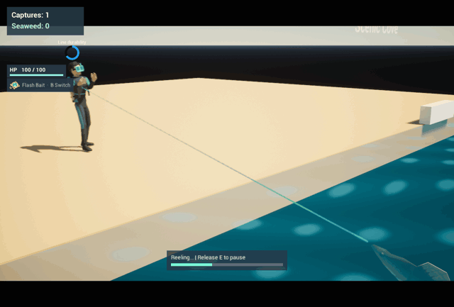
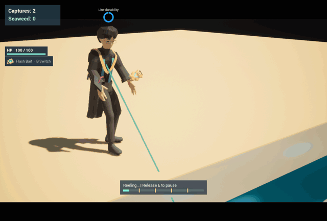

# Human Fishing

A Blueprint project for Unreal Engine 5.2.1.

## Gameplay demos

These clips were recorded in Unreal Editor. Developer mode was used to set up
the fishing encounters.

### Bait selection and capture

Switch from Dollar Bait to Flash Bait, skip the photographer with **Q**, and
reel in the tourist who approaches the same bait.

### Diver water reel

Reel the diver across the shoreline, through water drag, and into contact with
the fish.

### Elijah, backpack, and field guide

Release **E** during Elijah's 0.75-second brace cue, then resume reeling.
The capture appears as a **3×3** portrait in the backpack. Open the field guide
to read his capture tips.

### Scenic Cove and saves

Swim offshore into the deep ocean, pass through the rock arch into Scenic Cove,
then save and continue from the cove.

### Swimming and shore movement

The fish follows the camera while swimming. Its tail beats faster as it speeds
up and slows down at rest and on land.

## Run the project

Open `HumanFishing.uproject`. The standalone game opens the three-slot save menu. In the editor, play `L_SaveMenu` to use a save slot or play `L_ShorePrototype` directly for a temporary test session. Use WASD to move and the mouse to look. While swimming, look up or down and press W to change depth. Press Space to jump on land.

## Catching humans

Swim up to the surface and aim toward the beach. **Left-click** to cast along
the current aim, or press **E** to preview the trajectory first. Turn the camera
left or right to steer, look down to throw closer, and look up to throw farther.
When the landing ring is green, click or press **E** to cast. Press **Esc** to
cancel aiming. Test **Esc** in **Standalone Game**, since it stops Play in
Editor by default.

The fish has 100 HP. Landing on the beach drains 10 HP per second, including
while jumping. Returning to the shallows stops the damage. At zero HP, the cast
ends and the fish respawns in the deep ocean, where it recovers 20 HP per second.

Press **B** before casting to switch between Dollar Bait and Flash Bait.
Both are unlimited and available from the start. The HUD shows your selection,
which carries across areas for the current session. Dollar Bait is a folded
bundle of banknotes and Flash Bait is a glowing crystal in a brass frame. Their
HUD illustrations show the same models used in the cast. Every 10–16 seconds a
visitor can enter from either end of the beach, up to six at a time. Arriving
and wandering visitors can notice bait within their detection radius if they
have a path to it. Interest builds fastest within one meter.

With Dollar Bait, the first visitor to fill their interest ring approaches.
Flash Bait gives the highest eligible rarity priority, then breaks ties by
interest and distance. It builds interest twice as fast and gives each visitor
four more seconds to be hooked after they reach the bait.

Press **Q** to skip an approaching or inspecting visitor. They resume their
route, and the same bait waits for someone else. The skipped visitor can
respond again on the next cast. Press **E** to retrieve the bait while waiting
or while a visitor is approaching. At the hook prompt, **E** hooks and **X**
retrieves.

Press **E** at the hook prompt, release it, then hold **E** to reel. The blue ring
shows line durability and turns red at 25%. Releasing **E** pauses the pull while
the tourist keeps wearing down the line. The basic line lasts 12.5 seconds from
the moment you hook the tourist. Press **X** to end a cast. When you fish from
the water, the tourist stops at the dry edge of the beach. A catch fills the
first available space in the backpack and adds one to `Captures`. The tourist
returns to patrol if the backpack has no room for the catch.

When a worker braces, release **E** to avoid extra line wear during the next
tug. To catch a diver, cast from the shallows and reel them past the shore
until they touch the fish. Once they start swimming, water drag slows the pull
and raises line wear from 22 to 30 per second. A shorter stretch of water makes
the catch easier.

### Elijah

Elijah is a red-tier visitor in Scenic Cove. His character model follows the
[front, side, and back turnaround](docs/media/elijah-turnaround.png), with a
rebuilt head, solid-color skin, and a faceted center-parted haircut. He wears an
academic gown, carries a mortarboard and teddy bear, and has dedicated idle,
bait-inspection, and brace animations.

Elijah braces at 20%, 40%, 60%, and 80% of the reel bar. Each mark pauses movement,
progress, and normal line wear. Release **E** during the 0.75-second countdown
beside the durability ring and keep it released through the tug. The result
appears for 0.45 seconds. Holding through the tug costs 40 durability. Hold **E**
again after the result to continue reeling. A catch requires all four marks
and at least 3.2 seconds of active reeling, even on a short line.

### Backpack and field guide

Press **Tab** to pause and open the 4×4 backpack. A beach tourist occupies one
column and two rows. Click a catch to see its name, rarity, size, and total
seaweed value. To free its cells, click **Discard...**, then **Confirm
discard**. Drag catches to rearrange them. Press **Tab** or **Esc** to close the
backpack. Hold **E** again to resume reeling.

Switch to **Field Guide** from the pause panel to read field notes and capture
tips. A successful first catch reveals its entry even after you discard it.
**Save & Return** returns to the slot menu. Each slot keeps its own backpack,
guide, HP, capture count and seaweed. Continuing starts at the last area's
safe spawn point.

Tune `DollarAppeal` and `MaxLineDurability` in `BP_ShoreFishing` Class Defaults.
Visitor profiles live in `DA_HumanFishingCatalog`. Rarity affects spawn odds,
how long a visitor stays, and the catch's seaweed value per occupied cell.
The catalog's `GetCatchSeaweedValue` function reports the total value.
Footprints below are width by height, and interest drain and line wear are
measured per second.

| Visitor | Rarity | Footprint | Seaweed value | Dollar interest | Interest drain | Line wear |
| --- | --- | --- | --- | --- | --- | --- |
| Beach tourist | White | 1×2 | 2 | 1.25× | 8 | 8 |
| Casual woman | White | 2×1 | 2 | 1.05× | 11 | 6 |
| Farmer | Green | 2×2 | 8 | 0.85× | 6 | 10 |
| Lifeguard | Green | 1×3 | 6 | 1.15× | 10 | 7 |
| Worker | Blue | 2×3 | 18 | 0.90× | 9 | 15 |
| Delivery rider | Blue | 2×2 | 12 | 1.45× | 18 | 11 |
| Businessman | Purple | 1×3 | 15 | 1.70× | 20 | 17 |
| Surf instructor | Purple | 3×1 | 15 | 0.85× | 18 | 18 |
| Photographer | Gold | 3×2 | 48 | 0.72× | 22 | 20 |
| Diver | Gold | 2×3 | 48 | 0.65× | 25 | 22 on shore, 30 while swimming |
| Elijah | Red | 3×3 | 117 | 0.53× | 19 | 9 |

The `HumanFishingGameplay` project plugin provides the backpack and health UI.
On a fresh checkout, build the plugin with the UE 5.2 C++ toolchain for your
platform when Unreal prompts to rebuild the project modules. Catch sizes and
portraits are configured in `DA_HumanFishingCatalog`.

## Beach developer mode

Start Play in `L_ShorePrototype` in the editor or a Development build and
open the UE console with the backtick key (below Esc on a US keyboard).

| Command | Effect |
| --- | --- |
| `hf.dev on` | Start a temporary test, reveal the full Field Guide and pause random arrivals. |
| `hf.dev list` | List the visitor IDs in the current catalog. |
| `hf.dev spawn Diver` | Spawn a specific visitor on the beach near the fish. Replace `Diver` with any listed ID. |
| `hf.dev spawn Elijah` | Spawn Elijah to practice his brace and release timing. |
| `hf.dev off` | Restore progress and the area from before the test. |

Manual spawns bypass rarity, unlocks, and the crowd cap. They use the normal
visitor AI and can be caught. Testing can continue across both areas. Returning
to the menu or quitting discards the temporary test progress.

## Deep ocean travel

From the shoreline, turn away from the beach and swim offshore to enter the
deep ocean. The boundary behind you leads back to the original shore. Swim
toward the opposite edge and rise to the rock arch to enter Scenic Cove. Swim
offshore from the cove to return to the arch side of the deep ocean. The fish
triggers travel by swimming into the passage.

Scenic Cove uses spawn weights of 25 white, 15 green, 20 blue, 20 purple,
20 gold, and 2 red. Only rarities with an eligible visitor enter the roll.
The photographer and diver become eligible after three lifetime catches.
With all five standard rarities eligible, a Cove roll has a 20% chance of
gold, compared with about 5% at the original shore. Elijah joins the Cove pool
at six catches and takes 2 of 102 weight when all six rarities are eligible.
The photographer and Elijah stop spawning after their first catch in a save
slot. The diver can reappear. A save continued in Scenic Cove starts at the
Cove's safe spawn point.

The deep-ocean blockout has a larger swim area, an 18-meter-deep seabed, rocks, water
surface, and blue haze. Movement uses the existing fish Blueprint and the same controls.
The spawn points sit outside the travel zones to prevent immediate back-and-forth loads.

## Player counters and HUD

The upper-left HUD reads the inventory subsystem through `GetCaptureCount` and
`GetSeaweedBalance`. To change the balance, call `SetSeaweed` on the
`HumanFishingInventory` game-instance subsystem so the active slot autosaves.

| Asset | Purpose |
| --- | --- |
| `Content/HumanFishing/Maps/L_ShorePrototype` | Test map with a beach, a bounded swim area, and a graybox base |
| `Content/HumanFishing/Maps/L_DeepOcean` | Offshore swimming blockout with a return route |
| `Content/HumanFishing/Maps/L_ScenicCove` | Second beach beyond the deep ocean with its own visitor spawn weights |
| `Content/HumanFishing/Travel/BP_LevelTravelZone` | Fish-triggered level travel with an editable DestinationMap |
| `Content/HumanFishing/Maps/L_SaveMenu` | Start or continue one of three save slots |
| `Content/HumanFishing/Core/BP_HumanFishingGameInstance` | Game-instance Blueprint used by the project |
| `Content/HumanFishing/UI/WBP_PlayerHUD` | Bound capture/currency display |
| `Content/HumanFishing/Core/BP_HumanFishingGameMode` | Default game mode and pawn selection |
| `Content/HumanFishing/Player/BP_FishPlayer` | Player pawn with swimming, land movement, camera following, and swim animation speed control |
| `Content/Assets/Fish/A_FishSwim` | Looping fish tail animation |
| `Content/ThirdPerson/Input` | Enhanced Input assets used by the player |

The first gameplay milestone is moving the fish through the water area and delivering a placeholder catch to the base. Add fishing, NPC, and UI assets under `Content/HumanFishing` as those systems are implemented. Keep working copies of experimental maps separate from the shared prototype map.

Use regular Git for the project assets. Keep new assets under 20 MiB each and aim for a `Content` folder under 150 MiB for the first playable version. Keep builds and source art archives outside the repository. Check the distribution terms before adding third-party assets to this public repository.

Fish model: [Low poly fish](https://www.fab.com/listings/e6d7b903-fdea-4ce6-9d60-6ec09baaf78d) by Kultasusi.

Shore tourist: [Beach Character](https://poly.pizza/m/DojKLcO34E) by Quaternius, [CC0 1.0](https://creativecommons.org/publicdomain/zero/1.0/).

Original dollar asset: [Dollar](https://poly.pizza/m/YmaCrICQe2) by J-Toastie, [CC BY 3.0](https://creativecommons.org/licenses/by/3.0/). The current bait models and HUD illustrations were made for this project.
