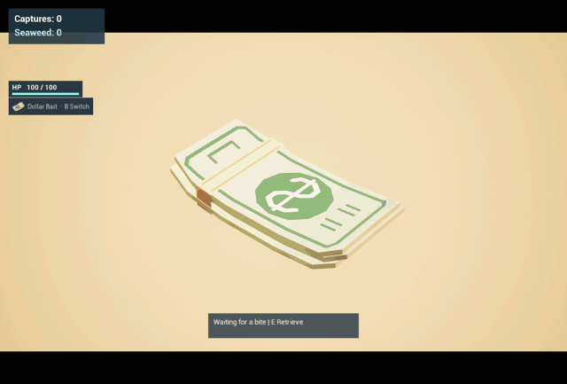
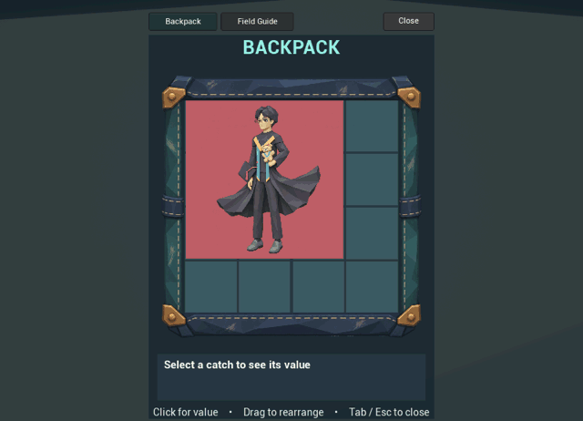
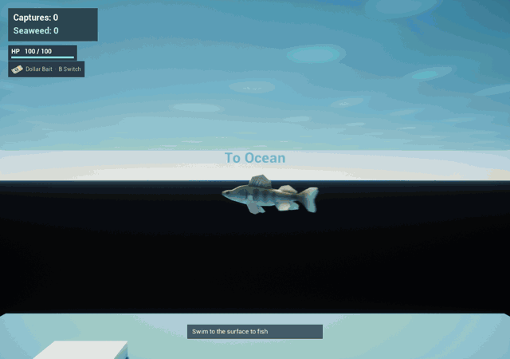

# Human Fishing

Swim to shore, lure visitors with bait, reel them in, and make room for your catches as you explore new fishing spots.

A Blueprint and C++ project for Unreal Engine 5.8.4.

## Movement and health

Move with **WASD** and look with the mouse. In the water, look up or down and
press **W** to rise or dive. On land, press **Space** to jump.

The fish has 100 HP and loses 10 HP per second while on the beach, including
while jumping. Returning to the shallows stops the damage. In the deep ocean,
the fish recovers 20 HP per second. At zero HP, the current cast ends and the
fish respawns in the deep ocean.

## Bait, casting, and reeling

Press **B** before casting to switch bait. Both types are unlimited and
available from the start, and the HUD shows which one is selected.

- **Dollar Bait** attracts the first visitor to fill their interest ring.
- **Flash Bait** prioritizes higher rarities among visitors who can reach the
  bait. It builds interest twice as fast and gives visitors four extra seconds
  to be hooked after they reach it.

Swim to the surface and aim toward the beach. **Left-click** to cast, or press
**E** to preview the trajectory. Steer with the camera, aiming down for a
shorter throw or up for a longer one. A green landing ring marks a valid cast.

When a visitor approaches or inspects the bait, press **Q** to pass on them.
The bait stays out for the next visitor. Press **E** to retrieve the bait while
waiting or while a visitor approaches. At the hook prompt, **E** hooks the
visitor and **X** retrieves the bait.

After hooking, release **E**, then hold it to reel. The ring above the visitor
shows line durability and turns red at 25%. During a normal pull, releasing
**E** pauses progress while the line continues to wear. Watch the prompts
when visitors struggle, and press **X** to end the cast. The Field Guide lists
capture tips for individual visitors.

## Backpack and field guide

Press **Tab** to pause and open the 4×4 backpack. A successful catch fills the
first space large enough for its footprint and adds to the capture counter.
If the backpack has no room, the visitor returns to patrol.

Drag catches to rearrange them. Select a catch to see its rarity, size, and
seaweed value. To free space, select **Discard…**, then **Confirm discard**.
Press **Tab** or **Esc** to close the backpack.

Open **Field Guide** from the pause panel to read visitor notes and capture
tips. The first successful catch reveals its entry, which stays available
after you discard the catch.

## Exploration and saves

Swim offshore from the beach to enter the deep ocean. One boundary leads back
to the original shore. On the opposite side, rise toward the rock arch to
enter Scenic Cove. Swim offshore from the cove to return to the arch side of
the deep ocean.

The two beaches have different visitor spawn weights. Scenic Cove gives blue,
purple, and gold visitors a higher chance to appear. Lifetime captures unlock
rarer visitors, and only eligible rarities enter a spawn roll.

The game offers three save slots. Each slot keeps its own backpack, Field Guide,
HP, captures, and seaweed balance. Choose **Save & Return** from the pause panel
to return to the menu. **Continue** starts at the last area's safe spawn point.

The fishing and inventory clips were recorded in Unreal Editor with developer mode
used to set up encounters.

## Visitor roster

Rarity affects spawn odds, how long a visitor stays, and seaweed value per
occupied cell. Footprints are width by height. Interest drain and line wear
are measured per second.

| Visitor | Rarity | Footprint | Seaweed value | Dollar interest | Interest drain | Line wear |
| --- | --- | --- | --- | --- | --- | --- |
| Beach tourist | White | 1×2 | 2 | 1.25× | 8 | 8 |
| Casual woman | White | 2×1 | 2 | 1.05× | 11 | 6 |
| Farmer | Green | 2×2 | 8 | 0.85× | 6 | 10 |
| Lifeguard | Green | 1×3 | 6 | 1.15× | 10 | 7 |
| Worker | Blue | 2×3 | 18 | 0.90× | 9 | 15 |
| Delivery rider | Blue | 2×2 | 12 | 1.45× | 18 | 11 |
| Businessman | Purple | 1×3 | 15 | 1.70× | 20 | 17 |
| Surf instructor | Purple | 3×1 | 15 | 0.85× | 18 | 18 |
| Photographer | Gold | 3×2 | 48 | 0.72× | 22 | 20 |
| Diver | Gold | 2×3 | 48 | 0.65× | 25 | 22 on shore, 30 while swimming |
| Elijah | Red | 3×3 | 117 | 0.53× | 19 | 9 |

## Run the project

Install Unreal Engine 5.8.4 and open `HumanFishing.uproject` with that editor.
The standalone game opens the save slot menu.
In the editor, play `L_SaveMenu` to use a save slot or `L_ShorePrototype` for
a temporary session. Test the **Esc** aim-cancel input in **Standalone Game**,
since **Esc** stops Play in Editor by default.

On a fresh checkout, accept the editor's prompt to rebuild the
`HumanFishingGameplay` plugin with the C++ toolchain for your platform.
On Apple Silicon, the project was verified with Xcode 26.6.

## Developer mode

Start play in `L_ShorePrototype` in the editor or in a Development build.
Open the console with the backtick key, below **Esc** on a US keyboard.

| Command | Effect |
| --- | --- |
| `hf.dev on` | Start a temporary test, reveal the full Field Guide, and pause random arrivals. |
| `hf.dev list` | List the visitor IDs in the current catalog. |
| `hf.dev spawn <type>` | Spawn a visitor of the given catalog type on the beach near the fish. |
| `hf.dev off` | Restore progress and the area from before the test. |

Manual spawns bypass rarity, unlocks, and the crowd cap. They use the normal
visitor AI and can be caught. Testing can continue across both beaches.
Returning to the menu or quitting discards temporary test progress.

## Technical notes

The `HumanFishingGameplay` plugin provides the backpack and health UI.
Tune `DollarAppeal` and `MaxLineDurability` in `BP_ShoreFishing` Class Defaults.
Visitor profiles, catch sizes, and portraits are configured in
`DA_HumanFishingCatalog`. Its `GetCatchSeaweedValue` function reports the total
value of a catch.

The upper-left HUD reads `GetCaptureCount` and `GetSeaweedBalance` from the
inventory subsystem. Call `SetSeaweed` on the `HumanFishingInventory`
game-instance subsystem to update the balance and autosave the active slot.

| Asset | Purpose |
| --- | --- |
| `Content/HumanFishing/Maps/L_ShorePrototype` | Test map with a beach, a bounded swim area, and a graybox base |
| `Content/HumanFishing/Maps/L_DeepOcean` | Offshore swimming blockout with a return route |
| `Content/HumanFishing/Maps/L_ScenicCove` | Second beach beyond the deep ocean with its own visitor spawn weights |
| `Content/HumanFishing/Travel/BP_LevelTravelZone` | Fish-triggered level travel with an editable DestinationMap |
| `Content/HumanFishing/Maps/L_SaveMenu` | Start or continue one of three save slots |
| `Content/HumanFishing/Core/BP_HumanFishingGameInstance` | Game-instance Blueprint used by the project |
| `Content/HumanFishing/UI/WBP_PlayerHUD` | Bound capture/currency display |
| `Content/HumanFishing/Core/BP_HumanFishingGameMode` | Default game mode and pawn selection |
| `Content/HumanFishing/Player/BP_FishPlayer` | Player pawn with swimming, land movement, camera following, and swim animation speed control |
| `Content/Assets/Fish/A_FishSwim` | Looping fish tail animation |
| `Content/ThirdPerson/Input` | Enhanced Input assets used by the player |

Use regular Git for the project assets. Keep new assets under 20 MiB each and aim for a `Content` folder under 150 MiB for the first playable version. Keep builds and source art archives outside the repository. Check the distribution terms before adding third-party assets to this public repository.

Fish model: [Low poly fish](https://www.fab.com/listings/e6d7b903-fdea-4ce6-9d60-6ec09baaf78d) by Kultasusi.

Shore tourist: [Beach Character](https://poly.pizza/m/DojKLcO34E) by Quaternius, [CC0 1.0](https://creativecommons.org/publicdomain/zero/1.0/).

Original dollar asset: [Dollar](https://poly.pizza/m/YmaCrICQe2) by J-Toastie, [CC BY 3.0](https://creativecommons.org/licenses/by/3.0/). The current bait models and HUD illustrations were made for this project.
