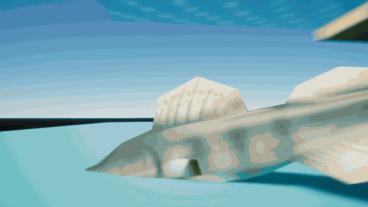
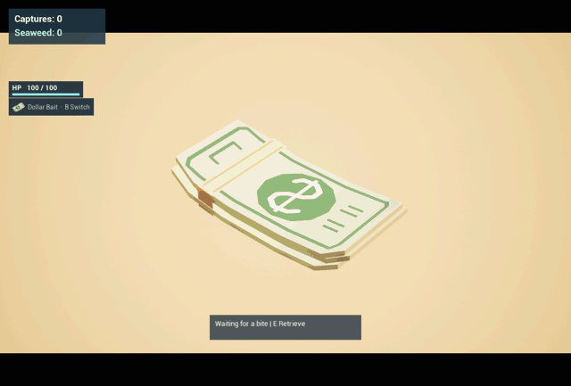
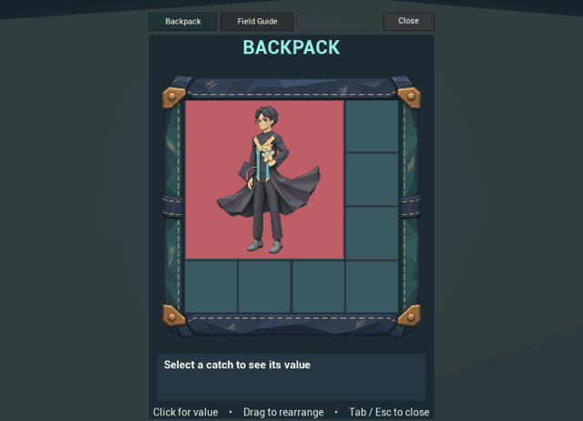
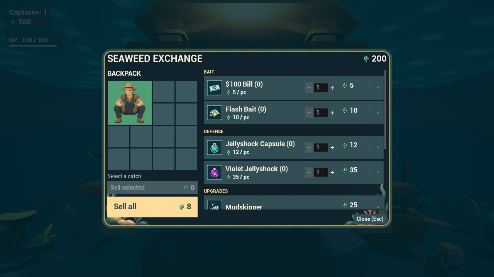
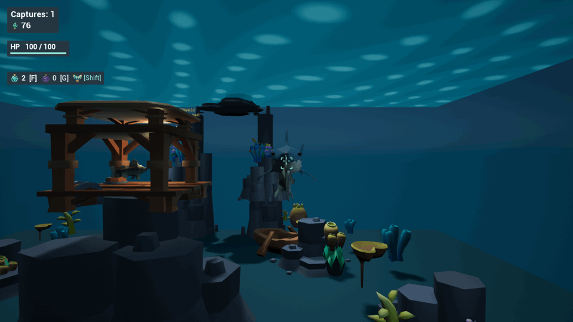
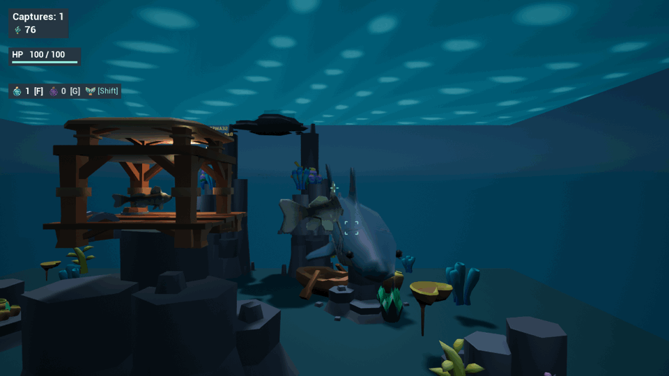
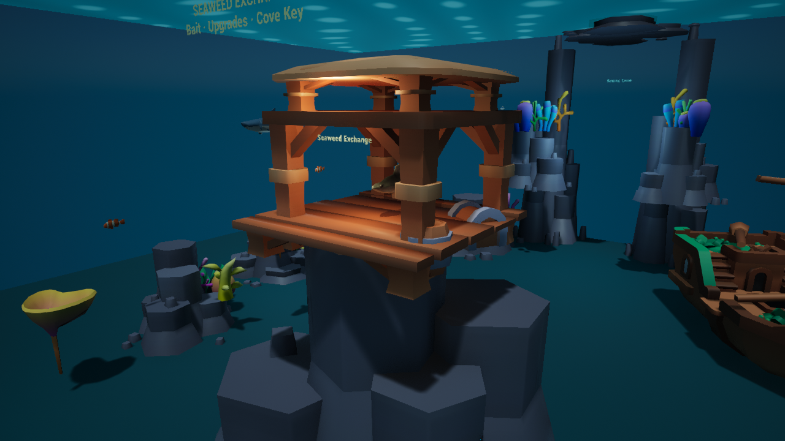
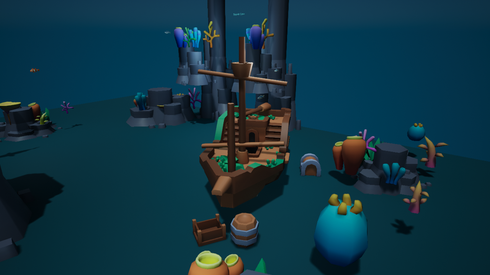
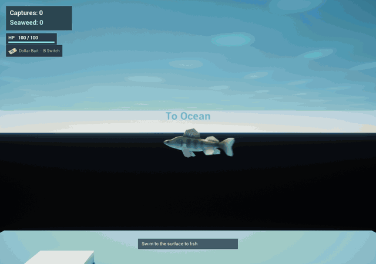

# Human Fishing

Swim to shore, lure visitors with bait, reel them in, and make room for your catches as you explore new fishing spots.

Built for **Unreal Engine 5.2.1**, with Blueprint content and a native gameplay plugin.
The current version includes consumable bait, a backpack-based trading economy,
key-gated travel, animated low-poly sharks, two jellyfish weapons and water sprint.

## Controls at a glance

| Input | Action |
| --- | --- |
| WASD + mouse | Move and look; swim toward the camera direction |
| Space | Jump on land |
| B | Cycle bait, including out-of-stock bait |
| Left-click / E | Cast / preview; E also hooks and reels when prompted |
| Q / X | Skip the approaching visitor / end the cast |
| E near a shop or entrance | Trade or travel; these interactions take priority over fishing |
| Tab / Esc | Open the backpack / pause; close the active panel |
| F / G underwater | Fire Jellyshock / Violet Jellyshock from separate consumable stocks |
| Shift underwater | Sprint after purchasing Tidal Fins |

## Movement and health

Move with **WASD** and look with the mouse. In the water, look up or down and
press **W** to rise or dive. On land, press **Space** to jump.

The fish has 100 HP and loses 10 HP per second while on the beach, including
while jumping. The Mudskipper upgrade halves this to 5 HP per second. Returning
to the shallows stops the damage. In the deep ocean,
the fish recovers 20 HP per second. At zero HP, the current cast ends and the
fish respawns in the deep ocean.



## Bait, casting, and reeling

Press **B** before casting to cycle **Dollar → $100 Bill → Flash → Dollar**.
Dollar Bait is free and unlimited. New games start with no advanced bait.
The HUD shows the selected bait and its available count. Empty bait stays
selectable, appears gray with `0`, and cannot be cast; restock at the shop.

- **Dollar Bait** attracts the first eligible visitor to fill their interest
  ring. The Businessman refuses it.
- **Flash Bait** prioritizes higher rarities among visitors who can reach the
  bait. It builds interest twice as fast and gives visitors four extra seconds
  to be hooked after they reach it.
- **$100 Bill** attracts every visitor, including the Businessman, with normal
  interest gain. It costs **5 seaweed per bill**.

Flash is the highest tier, costs **10 seaweed per bait**, and also attracts
the Businessman. Both advanced baits are consumables. A valid cast reserves one;
retrieving it before hooking returns it. Hooking, escape, failure, a broken line,
or death consumes it once. Invalid casts, aim cancellation, and **Q** skips do not
spend extra bait. Opening the pause menu, changing maps, or quitting normally
retrieves unhooked bait. Continuing a save starts without an active cast.

Swim to the surface and aim toward the beach. **Left-click** to cast, or press
**E** to preview the trajectory. Steer with the camera, aiming down for a
shorter throw or up for a longer one. A green landing ring marks a valid cast.

When a visitor approaches or inspects the bait, press **Q** to pass on them.
The bait stays out for the next visitor. Press **E** to retrieve the bait while
waiting or while a visitor approaches. At the hook prompt, **E** hooks the
visitor and **X** retrieves the bait.

After hooking, release **E**, then hold it to reel. The ring above the visitor
shows line durability and turns red at 25%. During a normal pull, releasing
**E** pauses progress while the line continues to wear. Watch the prompts
when visitors struggle, and press **X** to end the cast. The Field Guide lists
capture tips for individual visitors.



## Backpack and field guide

Press **Tab** to pause and open the backpack, initially 4×4. Buy **Backpack Expansion**
at the Seaweed Exchange for 50 seaweed to permanently expand it to 5×4.
A successful catch fills the
first space large enough for its footprint and adds to the capture counter,
which shows how many catches the backpack holds.
If the backpack has no room, the visitor returns to patrol.

Drag catches to rearrange them. Select a catch to see its rarity, size, and
seaweed value. To free space, select **Discard…**, then **Confirm discard**.
Press **Tab** or **Esc** to close the backpack.

Open **Field Guide** from the pause panel to read visitor notes and capture
tips. The first successful catch reveals its entry, which stays available
after you discard the catch.



## Ocean shop

Swim up to the wooden Seaweed Exchange stall in the deep ocean and press **E** to trade.
Redeem the catches in your backpack for seaweed. Then, use the seaweed to
purchase upgrades. Press E, Esc, Tab, or Close to return to swimming.

The shop puts the live backpack on the left, including its extra column after expansion. Select a catch and choose
**Sell selected**, or use the prominent **Sell all** button to redeem the whole
backpack. Lifetime captures and Field Guide entries are kept.

Products are grouped on the right. Click an item name or its arrow to expand its
description. Each consumable has its own quantity control (1–99), per-item price and
purchase total, with no bulk discount. Permanent upgrades show their price once,
on the purchase button. Icons retain their original proportions. The seaweed icon represents currency
throughout the HUD, shop, backpack and locked entrance prompt. Purchases autosave.
The HUD uses `Flash Bait (3) | Switch(B)` for compact stock feedback.

| Item | Seaweed price | Effect |
| --- | ---: | --- |
| $100 Bill | 5 each | Attracts all visitors, including the Businessman |
| Flash Bait | 10 each | All visitors; rarity priority, ×2 interest, +4 seconds to hook |
| Mudskipper | 25 | Permanently halves damage on land |
| Braided Line | 40 | Permanently adds 25% line durability |
| Backpack Expansion | 50 | Permanently expands the backpack from 4×4 to 5×4 |
| Jellyshock Capsule | 12 each | Press F underwater; the first shark hit is stunned for 30 seconds |
| Violet Jellyshock | 35 each | Press G underwater; defeats the first shark hit in a violet nova |
| Tidal Fins | 50 | Permanently unlocks Shift water sprint: 1.6× speed for up to 5 seconds |
| Scenic Cove Key | 60 | Permanently unlocks Scenic Cove |



Backpack Expansion adds its fifth column immediately, including in the open shop:


## Sharks

Buy **Jellyshock Capsules** at the Seaweed Exchange. Aim with the camera and press
**F** underwater to launch one. A successful launch uses one capsule even if it
misses; walls block the shot. A stunned shark cannot move, bite or steal for
30 seconds. Another hit refreshes the duration, and the shark gets a 2-second
recovery grace period before chasing again.

The center crosshair turns seafoam when a visible shark is within the 8-degree
assist cone and 30-meter launch range. Firing applies a small movement lead
(at most half a second); the jellyfish then flies straight. Rocks and walls
prevent target assistance. A blocked launch point shows a warning and spends
no capsule. The 50-centimeter sweep radius makes close misses more forgiving.

The capsule releases a luminous low-poly jellyfish matching the shop illustration:
a translucent teal bell, warm lightning core and three curled, swaying tentacles.
Its electric wake and bubble trail lead into a 1.1-second discharge with expanding
pressure rings, branching arcs and outward bubbles. The wide visual burst still
stuns only the first shark hit; a wall impact produces a smaller fizzle.



**Violet Jellyshock** is the premium, lethal version. Press **G** to fire one
from its separate stock. A hit defeats and removes that shark immediately in a
larger violet discharge with three pressure rings, sixteen arcs and more bubbles.
It affects one shark, and walls still block it. Sharks respawn with the area's
normal placed actors when the map reloads; defeats are not permanent save flags.
Both variants share the same aim assistance and short firing cooldown.



**Tidal Fins** permanently unlock **Shift** sprint while swimming. Full energy
lasts 5 seconds; after releasing Shift, recharge starts after a 1-second rest and
takes 8 seconds from empty. Release and press again after exhaustion. Land speed
is unchanged. The small energy meter appears while using or recharging the fins.

Sharks use the supplied skeletal swim cycle with speed-dependent tail motion and
smooth banking. The modified CC0 shark has a separate lower-jaw bone and mouth
cavity; a lightweight native animation graph adds jaw opening without interrupting
the swim cycle. Both map sharks and `hf.shark` use this appearance.

Sharks patrol the deep ocean. If the fish swims within a shark's detection
range, the shark gives chase and an alert appears at the top of the screen.
A fuller backpack draws more attention: with every backpack cell in use,
sharks notice the fish from 50% farther away and chase 25% faster.

Each bite costs 25 HP and steals the most valuable catch in the backpack.
Lifetime captures, Field Guide entries, and seaweed are kept. After a bite,
the shark ignores the fish for a few seconds and the deep ocean stops healing
the fish for 4 seconds. At zero HP, the fish returns to where it entered the
deep ocean. Swim far enough away and the shark gives up and returns to its
patrol. Sharks leave the fish alone while the shop or backpack is open.

To add a shark, place `HumanFishingShark` (C++ class, under
`HumanFishingGameplay`) or a Blueprint subclass of it in `L_DeepOcean`. Its
placed location is the center of its patrol area. Select it to see its
patrol (green), detection (orange), and give-up (blue) ranges. Tune speeds and
ranges under **Shark** in the Details panel. Both placed sharks and `hf.shark`
use the Quaternius low-poly skeletal shark and looping swim animation, with
swim speed matched to movement. Patrol, chase, collision and bite logic are
unchanged. `OnSharkStateChanged` and `OnCatchesStolen` remain available.

## Exploration and saves

Approach a marked reef entrance and press **E** to travel. All four exits show
their destination and distance, with an on-screen prompt inside their interaction
range. The ocean entrance volumes span the visible rock-arch openings, including
deeper approaches; no floating sphere or range sprite is displayed. Moving
through an entrance alone does not change maps. The original
shore is on the east side of the deep ocean; Scenic Cove is through the western
rock arch, near the shipwreck. Buy the **60-seaweed Scenic Cove Key** at the
Seaweed Exchange first. The locked entrance explains the requirement.

Travel saves before a short fade, then places the fish outside the return trigger.
Returning from the cove preserves the `Arrival=ScenicCove` spawn. Menus and the
shop take input before entrances, which take input before fishing.

The underwater route now uses authored coral, rock, sea-grass, wreck and market
models, with ambient animated fish. Ambient sky lighting and soft fills keep the
reefs, wreck and entrances readable without relying on the market's lamp.
See [asset credits](docs/THIRD_PARTY_ASSETS.md)
and the [dependency and size audit](docs/asset-audit.md).
The [UI art set and prompts](docs/ui-assets.md) document the generated ocean theme.





The two beaches have different visitor spawn weights. Scenic Cove gives blue,
purple, and gold visitors a higher chance to appear. Lifetime captures unlock
rarer visitors, and only eligible rarities enter a spawn roll.

The game offers three save slots. Each slot keeps its own backpack, Field Guide,
HP, captures, seaweed balance, consumable bait counts, upgrades and Cove access.
Saves now use version 4 and retain equipment purchases plus both capsule stocks.
Versions 1–3 migrate automatically; existing progress is retained and violet
stock starts at zero.
Version 1 saves keep their migration rules: an old permanent $100 Bill purchase receives
30 seaweed once; a save already located in Scenic Cove keeps it unlocked.
Choose **Save & Return** from the pause panel
to return to the menu. **Continue** starts at the last area's safe spawn point.



The shop-expansion and jellyfish GIFs show the current packaged Mac Development
build with scripted encounters in a disposable profile. The short teal clip shows
the hit and initial stun; the stun lasts 30 seconds. Earlier swimming, fishing,
inventory and travel clips were recorded in Unreal Editor and may show older UI.

## Visitor roster

Rarity affects spawn odds, how long a visitor stays, and seaweed value per
occupied cell. Footprints are width by height. Interest drain and line wear
are measured per second.

| Visitor | Rarity | Footprint | Seaweed value | Bait interest | Interest drain | Line wear |
| --- | --- | --- | --- | --- | --- | --- |
| Beach tourist | White | 1×2 | 2 | 1.25× | 8 | 8 |
| Casual woman | White | 2×1 | 2 | 1.05× | 11 | 6 |
| Farmer | Green | 2×2 | 8 | 0.85× | 6 | 10 |
| Lifeguard | Green | 1×3 | 6 | 1.15× | 10 | 7 |
| Worker | Blue | 2×3 | 18 | 0.90× | 9 | 15 |
| Delivery rider | Blue | 2×2 | 12 | 1.45× | 18 | 11 |
| Businessman | Purple | 1×3 | 15 | 1.70× | 20 | 17 |
| Surf instructor | Purple | 3×1 | 15 | 0.85× | 18 | 18 |
| Photographer | Gold | 3×2 | 48 | 0.72× | 22 | 20 |
| Diver | Gold | 2×3 | 48 | 0.65× | 25 | 22 on shore, 30 while swimming |
| Elijah | Red | 3×3 | 117 | 0.53× | 19 | 9 |

## Run the project

Open `HumanFishing.uproject`. The standalone game opens the save slot menu.
In the editor, play `L_SaveMenu` to use a save slot or `L_ShorePrototype` for
a temporary session. Test the **Esc** aim-cancel input in **Standalone Game**,
since **Esc** stops Play in Editor by default.

On a fresh checkout, build the `HumanFishingGameplay` plugin with the Unreal
Engine 5.2 C++ toolchain for your platform when the editor prompts you to
rebuild project modules.

On macOS, with UE 5.2.1 installed, run the repeatable plugin build after source
changes (close this project's editor first):

```sh
python3 Scripts/build_macos.py
```

Set `UE_ROOT` if the engine is not at `/Users/Shared/Epic Games/UE_5.2`.
On newer Xcode installations, the script provides a local `xcodebuild -version`
response of **15.4** only to UnrealBuildTool. It uses the installed compiler with
`-Wno-deprecated-literal-operator -fno-access-control` for UE 5.2 headers and
`-OverrideBuildEnvironment`. It does not change the engine or system Xcode.
Build artifacts are cached in `/private/tmp/humanfishing-build-ue52`; previous
plugin binaries are backed up under `Saved/PluginBackups` before installation.

Validation commands:

```sh
python3 Scripts/validate_project.py tests --filter HumanFishing.Shop.BackpackUpgrade
python3 Scripts/validate_project.py tests --filter HumanFishing.Equipment
python3 Scripts/validate_project.py smoke
```

Optional full checks:

```sh
python3 Scripts/validate_project.py tests
python3 Scripts/validate_project.py blueprints
python3 Scripts/validate_project.py cook
python3 Scripts/validate_project.py standalone
```

Logs and reports are written under `Saved/Validation`. The editor-only migration
scripts under `Scripts` document model import, Blueprint integration and map layout;
they are not required to play an existing checkout.
The Standalone fixture uses `/private/tmp/humanfishing-validation-profile` and
does not read or overwrite player save slots. It exercises the normal inventory,
shop, travel and save interfaces, and captures both 1280×720 and 1920×1080 UI.
The short `smoke` check opens the shop, expands the backpack, buys equipment,
checks actual shark bone motion and jaw opening, and confirms capsule consumption,
temporary stun, recovery and a violet defeat in an isolated shark encounter.
See [validation notes](docs/validation.md) for results
and the manual checks left to the player.

### Package for macOS

The Mac preset targets 60 FPS, uses TAA and 75% scene rendering while retaining
native Retina UI. Lumen, virtual shadows, distance fields and unused heavy
postprocessing are disabled. Existing Mac settings receive this preset once;
save slots, audio and window preferences are preserved. Native fullscreen size
and input synchronization is described in [macOS display notes](docs/macos-display.md).

Use Unreal Engine **5.2.1** and keep these project files in version control so
each checkout gets the same display defaults.

For a repeatable Development build with the local Xcode compatibility shim:

```sh
python3 Scripts/package_macos.py
```

The current app is written to `Build/Mac-Walkthrough/HumanFishing.app`.
For a walkthrough, `Scripts/prepare_walkthrough_save.py` can top up an existing
local save while preserving its other serialized progress fields and checksum.
Original saves are backed up under `Saved/WalkthroughBackups`. Save files and
packaged builds are local artifacts and are not included in the repository.

| File | Purpose |
| --- | --- |
| `Config/Mac/MacGameUserSettings.ini` | Starts new profiles in windowed mode and lets Unreal choose the resolution for the display. |
| `Config/Mac/MacEngine.ini` | Enables high DPI in game and sets the viewport's secondary resolution scale to 100%. |
| `Source/HumanFishing/Resources/Mac/Info.plist` | Enables Retina support in the generated Mac app bundle. |

In Unreal Editor, use **Platforms → Mac → Package Project** and choose a fresh
output folder. If the packaged bundle fails the Retina check below, enable
**Build → Always** and **Full Rebuild** in **Project Settings → Packaging** and
package again. [Epic's packaging guide](https://dev.epicgames.com/documentation/en-us/unreal-engine/packaging-your-project)

Check the new app in Terminal. The first command after setting the path should
print `true`. The launch uses a temporary profile so existing display settings
and save slots stay separate from the test.

```sh
app="/path/to/HumanFishing.app"
plutil -extract NSHighResolutionCapable raw "$app/Contents/Info.plist"
profile=$(mktemp -d "${TMPDIR:-/tmp}/humanfishing-test.XXXXXX") &&
  "$app/Contents/MacOS/HumanFishing" "-UserDir=$profile"
```

Verify that the game opens in a window at a usable size, then enter Scenic Cove
and check that menu and backpack buttons respond at their visible positions.

### Refresh the README GIFs

After packaging, capture the short shop and equipment fixture in its disposable
profile. It does not use the player's save slots:

```sh
python3 Scripts/validate_project.py smoke --packaged --readme-capture
swift -module-cache-path /private/tmp/hf-swift-cache Scripts/encode_readme_gif.swift Saved/Validation/ReadmeFrames/shop-expansion docs/media/shop-expansion.gif
swift -module-cache-path /private/tmp/hf-swift-cache Scripts/encode_readme_gif.swift Saved/Validation/ReadmeFrames/jellyshock-stun docs/media/jellyshock-stun.gif
swift -module-cache-path /private/tmp/hf-swift-cache Scripts/encode_readme_gif.swift Saved/Validation/ReadmeFrames/violet-jellyshock docs/media/violet-jellyshock.gif 960 1.8
```

The macOS encoder uses ImageIO and keeps image proportions. Raw captures remain
under ignored `Saved/Validation`; only the compressed GIFs belong in Git.

## Developer mode

Start play in `L_ShorePrototype` in the editor or in a Development build.
Open the console with the backtick key, below **Esc** on a US keyboard.

| Command | Effect |
| --- | --- |
| `hf.dev on` | Start a temporary test, reveal the full Field Guide, and pause random arrivals. |
| `hf.dev list` | List the visitor IDs in the current catalog. |
| `hf.dev spawn <type>` | Spawn a visitor of the given catalog type on the beach near the fish. |
| `hf.dev off` | Restore progress and the area from before the test. |
| `hf.shark [distance]` | Spawn a test shark ahead of the fish (default 2000 units). Works in any level. |
| `hf.give <type> [count]` | Add catches of a visitor type to the backpack. Run without arguments to list types. Works in any level. |
| `hf.seaweed <amount>` | Set the seaweed balance. Works in any level. |
| `hf.shop` | Open the shop directly for UI checks in a Development game. |

`hf.give` and `hf.seaweed` save to the current slot unless `hf.dev on` is active.

Manual spawns bypass rarity, unlocks, and the crowd cap. They use the normal
visitor AI and can be caught. Testing can continue across both beaches.
Returning to the menu or quitting discards temporary test progress.

## Technical notes

The `HumanFishingGameplay` plugin provides the backpack and health UI.
Tune `DollarAppeal` and `MaxLineDurability` in `BP_ShoreFishing` Class Defaults.
Visitor profiles, catch sizes, and portraits are configured in
`DA_HumanFishingCatalog`. Its `GetCatchSeaweedValue` function reports the total
value of a catch.

The upper-left HUD reads `GetCaptureCount` and `GetSeaweedBalance` from the
inventory subsystem. Call `SetSeaweed` on the `HumanFishingInventory`
game-instance subsystem to update the balance and autosave the active slot.

| Asset | Purpose |
| --- | --- |
| `Content/HumanFishing/Maps/L_ShorePrototype` | Test map with a beach, a bounded swim area, and a graybox base |
| `Content/HumanFishing/Maps/L_DeepOcean` | Coral reefs, seaweed market, shipwreck and marked return routes |
| `Content/HumanFishing/Maps/L_ScenicCove` | Second beach beyond the deep ocean with its own visitor spawn weights |
| `HumanFishingTravelZone` | Native E-to-travel actor with DestinationMap, ArrivalTag, key gate and save/fade |
| `Content/HumanFishing/Maps/L_SaveMenu` | Start or continue one of three save slots |
| `Content/HumanFishing/Core/BP_HumanFishingGameInstance` | Game-instance Blueprint used by the project |
| `Content/HumanFishing/UI/WBP_PlayerHUD` | Bound capture/currency display |
| `Content/HumanFishing/Core/BP_HumanFishingGameMode` | Default game mode and pawn selection |
| `Content/HumanFishing/Player/BP_FishPlayer` | Player pawn with swimming, land movement, camera following, and swim animation speed control |
| `Content/Assets/Fish/A_FishSwim` | Looping fish tail animation |
| `Content/ThirdPerson/Input` | Enhanced Input assets used by the player |

Use regular Git for the project assets. Keep new assets under 20 MiB each and aim for a `Content` folder under 150 MiB for the first playable version. Reimport sources for the selected ocean models are under `SourceArt/Ocean`, outside cooked `Content`; whole downloaded packs and generated builds are not added to Git. Check distribution terms before adding third-party assets to this public repository.

The Blueprint-callable inventory API is `GetBaitCount`, `BuyBait`,
`ReserveSelectedBait`, `CommitHookedBait`, and `FinishBaitUse`. The fishing graph
uses world-context wrappers `ReserveFishingBait`, `HookFishingBait`, and
`FinishFishingBait`, with input guards and pre-hook pause retrieval. Reservations
are transient; only committed consumption changes the durable owned count.

Fish model: [Low poly fish](https://www.fab.com/listings/e6d7b903-fdea-4ce6-9d60-6ec09baaf78d) by Kultasusi.

Shore tourist: [Beach Character](https://poly.pizza/m/DojKLcO34E) by Quaternius, [CC0 1.0](https://creativecommons.org/publicdomain/zero/1.0/).

Original dollar asset: [Dollar](https://poly.pizza/m/YmaCrICQe2) by J-Toastie, [CC BY 3.0](https://creativecommons.org/licenses/by/3.0/). The current bait models and HUD illustrations were made for this project.
