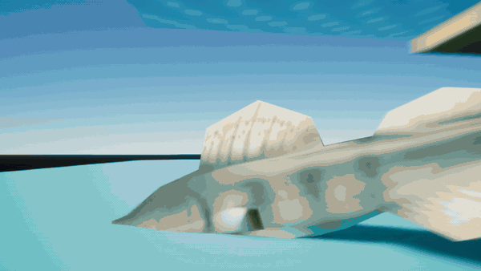

# Human Fishing

A Blueprint project for Unreal Engine 5.2.1.

## Gameplay demo

This prototype clip follows the player-controlled fish as it swims underwater, crosses onto the beach, and dives back in.

## Run the project

Open `HumanFishing.uproject` and click **Play** in `L_ShorePrototype`. Use WASD to move, the mouse to look, and Space to jump. The player uses the low-poly fish model while the team builds swimming and fishing.

| Asset | Purpose |
| --- | --- |
| `Content/HumanFishing/Maps/L_ShorePrototype` | Test map with a player start, shore, water area, and base marked with graybox geometry |
| `Content/HumanFishing/Core/BP_HumanFishingGameMode` | Default game mode and pawn selection |
| `Content/HumanFishing/Player/BP_FishPlayer` | Player pawn with the Third Person template input and camera |
| `Content/ThirdPerson/Input` | Enhanced Input assets used by the player |

The first gameplay milestone is moving the fish through the water area and delivering a placeholder catch to the base. Add fishing, NPC, and UI assets under `Content/HumanFishing` as those systems are implemented. Keep working copies of experimental maps separate from the shared prototype map.

Use regular Git for the project assets. Keep new assets under 20 MiB each and aim for a `Content` folder under 150 MiB for the first playable version. Keep builds and source art archives outside the repository. Check the distribution terms before adding third-party assets to this public repository.

Fish model: [Low poly fish](https://www.fab.com/listings/e6d7b903-fdea-4ce6-9d60-6ec09baaf78d) by Kultasusi.
